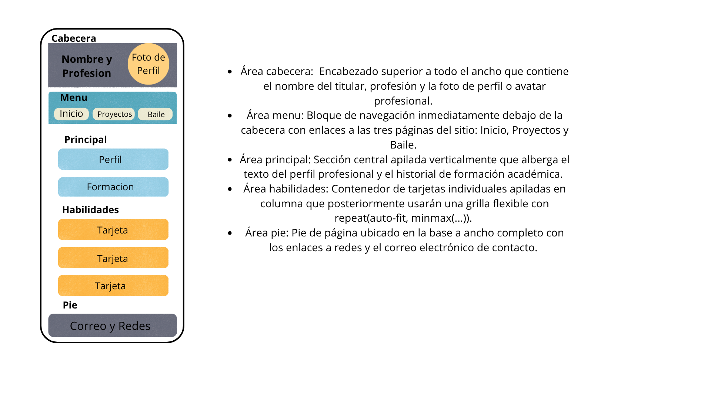
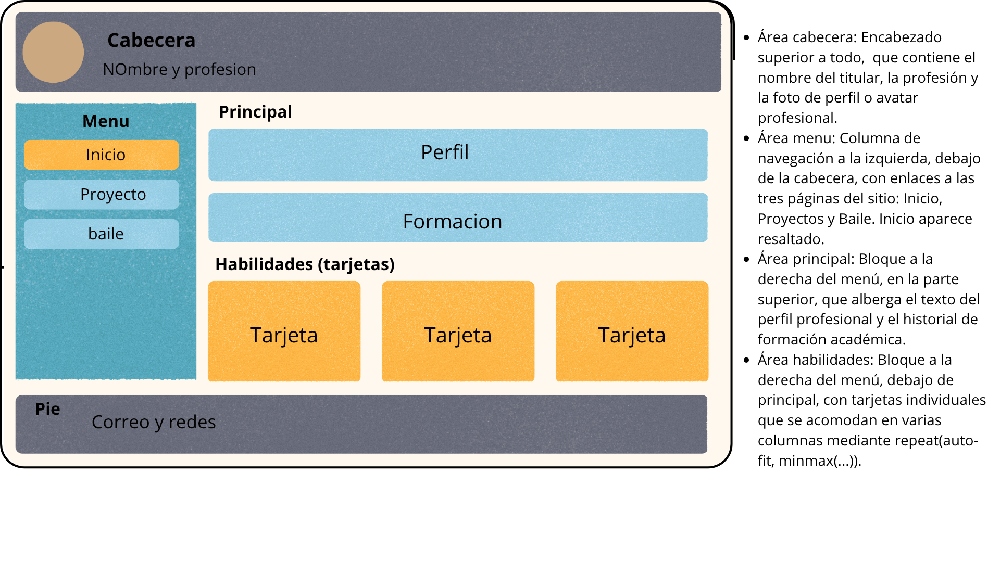
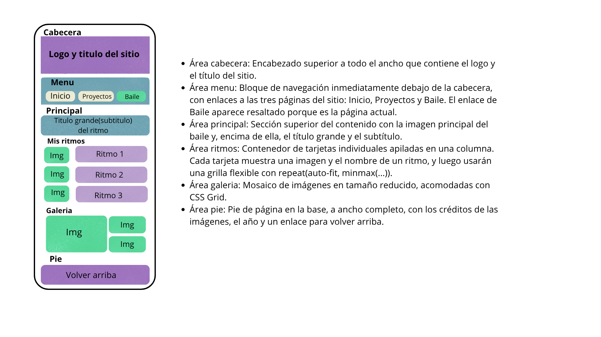
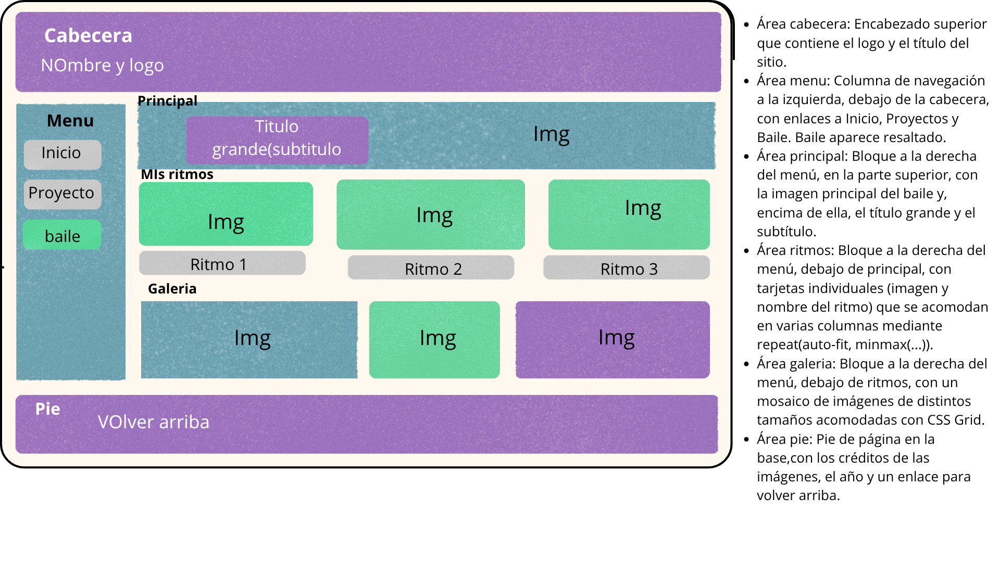
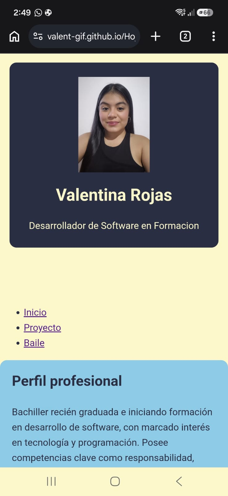
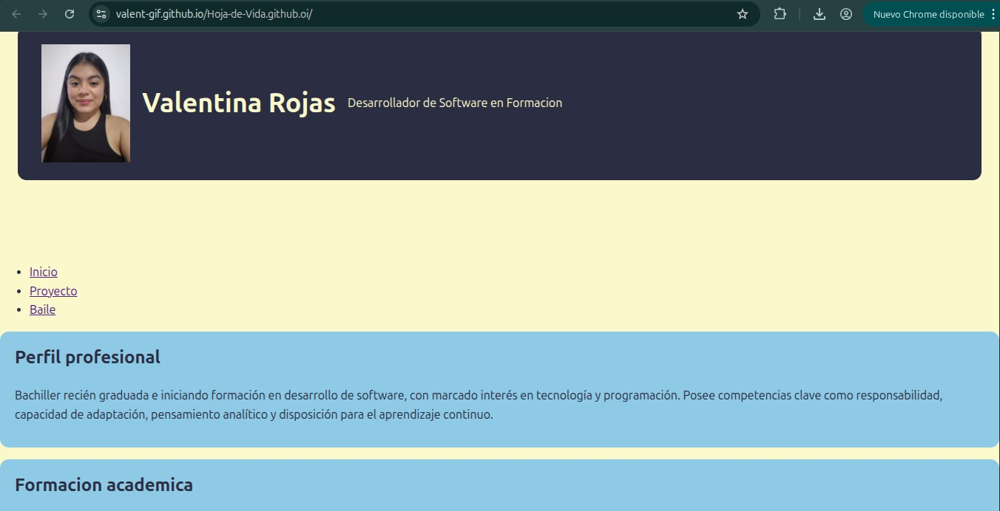

# Hoja de vida web · Valentina Rojas

Sitio personal responsive con mi hoja de vida, un proyecto que ya desarrollé (la página de la panadería Pan-Pa'Ti) y una página sobre mi pasión por el baile. Está hecho con HTML y CSS (Grid y media queries), con enfoque Mobile First, y se ve bien en celular, tablet y computador.

**Sitio publicado:** https://valent-gif.github.io/hoja-de-vida/

## Páginas

- [`index.html`](index.html): hoja de vida (perfil profesional, formación académica y habilidades).
- [`proyectos.html`](proyecto.html): proyecto Pan-Pa'Ti, sitio web de una panadería artesanal.
- [`baile.html`](baile.html): página sobre el baile, con mis ritmos favoritos y una galería de imágenes.

Las tres páginas usan un único archivo de estilos (`styles.css`) y el mismo menú de navegación.

## Mockups

Antes de programar diseñé cada página en Canva, en versión celular y computador, marcando las áreas del grid (`grid-template-areas`).

### Hoja de vida

Áreas: `cabecera`, `menu`, `principal`, `habilidades` y `pie`.

### Proyectos

Áreas: `cabecera`, `menu`, `principal` y `pie`.

### Baile

Áreas: `cabecera`, `menu`, `principal`, `ritmos`, `galeria` y `pie`.

## Capturas del sitio publicado

### Celular (dispositivo real)

### Computador

## Breakpoints

El CSS es Mobile First: el diseño base es para celular y los `@media (min-width: ...)` van al final del archivo, de menor a mayor.

- **Base (celular, menos de 600px):** todo en una sola columna, con las áreas apiladas en orden (cabecera, menú, contenido y pie). El menú son botones en fila que se ajustan al ancho. En la cabecera, la foto va arriba y el nombre debajo. Las tarjetas de habilidades y de ritmos se muestran en una columna, y el mosaico de la galería en 2 columnas.
- **Desde 600px (tablet):**
  - La cabecera pasa a fila: la foto queda a la izquierda del nombre, que se agranda.
  - Aumentan los espacios de la página.
  - Las tarjetas se acomodan en 2 o más columnas, gracias a `repeat(auto-fit, minmax(...))`.
  - En baile, la imagen principal se hace más ancha y el mosaico pasa a 4 columnas con imágenes de distintos tamaños.
  - En proyectos, el menú interno de la panadería queda en línea y el mapa crece.
- **Desde 1024px (computador):**
  - Cambia `grid-template-areas`: el menú pasa a una columna vertical a la izquierda (14rem) y el contenido queda a la derecha.
  - La cabecera y el pie ocupan todo el ancho.
  - En inicio, `principal` y `habilidades` se apilan en la columna derecha.
  - En baile, `principal`, `ritmos` y `galeria` se apilan en la columna derecha, con imagen principal más panorámica y filas de galería más altas.
  - En proyectos, el proyecto Pan-Pa'Ti ocupa la columna derecha.

## Cómo lo publiqué

1. Creé una cuenta en GitHub y un repositorio **público** llamado `hoja-de-vida`.
2. Subí todos mis archivos al repositorio (`index.html`, `proyectos.html`, `baile.html`, `styles.css` y las carpetas `img`, `mockups` y `capturas`).
3. Entré a **Settings → Pages** del repositorio.
4. En *Build and deployment* elegí **Deploy from a branch**, con la rama `main` y la carpeta `/ (root)`, y guardé.
5. Esperé unos minutos, hasta que GitHub mostró el enlace del sitio publicado.
6. Abrí el enlace desde el computador y desde mi celular para comprobar que los enlaces entre páginas y las imágenes funcionaran.
7. Verifiqué que el repositorio y el sitio se abren desde una ventana de incógnito.

Lo que aprendí en el proceso:

- La página principal debe llamarse exactamente `index.html`, porque es el archivo que GitHub Pages abre por defecto al entrar al sitio.
- GitHub Pages distingue mayúsculas de minúsculas, así que todos mis archivos están en minúsculas, sin espacios ni tildes.
- Las rutas deben ser relativas (por ejemplo `img/foto.jpg`), porque las rutas absolutas de mi computador no existen en internet.

## Fuentes consultadas

- Documentación oficial de GitHub Pages: https://docs.github.com/es/pages
- Validador de HTML del W3C: https://validator.w3.org/
- MDN Web Docs, CSS Grid: https://developer.mozilla.org/es/docs/Web/CSS/CSS_grid_layout
- MDN Web Docs, media queries: https://developer.mozilla.org/es/docs/Web/CSS/CSS_media_queries